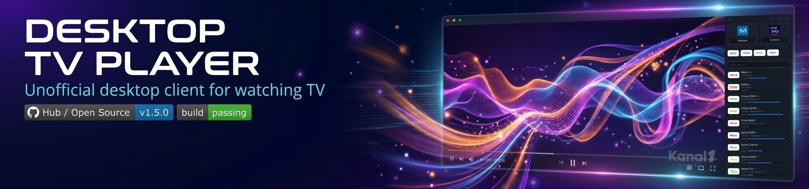
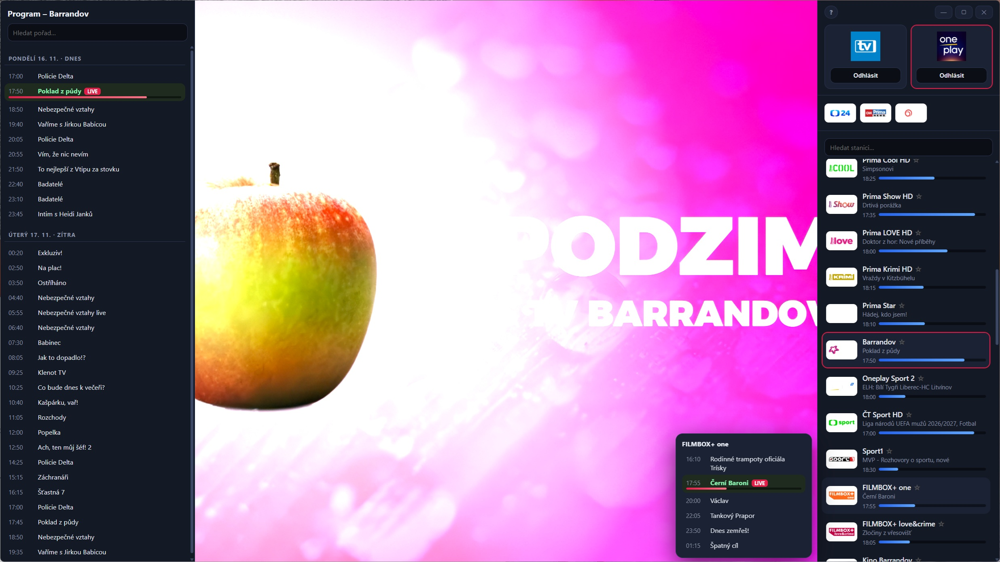

# TV Client

A replacement GUI for online TV platforms — a lightweight desktop client for Windows.
The design is defined in HTML so parts of the original pages integrate easily.

## User Manual

### Getting Started & Login
- Launch `tv-client.exe` (portable single-instance Windows app; launching it again focuses the existing window).
- Move your mouse to the **right edge** of the window to open the main menu.
- Click **Sign in** on **SledováníTV** or **Oneplay** and enter your credentials once. Credentials are stored encrypted locally and sessions refresh automatically on startup.
- For **Oneplay**, choose your profile after logging in.
- Below the sources, in **Basic Settings**, you can switch the UI **Language** (**English** default / **Čeština**) and enable **Launch at startup** to start TV Client automatically with Windows. Use the triangle button near the top-right to collapse the source cards to compact icons (prevents accidental logout).

### Watching TV & Controls
- **Switch channels:** Click any station in the right menu, click a favorite icon, or use `↑` / `↓` arrow keys.
- **Favorites:** Click the star on a station to add/remove it from favorites. Drag & drop favorite tiles to reorder them (per source).
- **Pause / Resume:** Click the video area or press `Space`.
  - On **live TV** with timeshift support, unpausing automatically switches to archive/timeshift mode from the exact paused position (channels without timeshift jump back to the live edge).
  - On **timeshift / archive** playback, pause and resume work normally from the exact paused position.
- **Window controls:** Double-click the video or press `F` to maximize/restore; drag the video area to move the window; press `Esc` to close open panels/dialogs. Top-right buttons provide help (`?`), minimize, maximize, and close.
- **Volume:** Adjust the slider or click the speaker icon in the right menu to mute/unmute.
- **Video filters & GPU shaders:** Move your mouse to the **top edge** of the window to open the **Video Filters** popup: choose a preset (*Default*, *Cinema*, *Sports / Live*, *Night*), fine-tune **Brightness**, **Contrast**, **Saturation**, and **Warmth**, or enable real-time WebGL2 **Sharpening (CAS)** and **Upscaling (GPU shader)** (non-DRM streams). Settings are remembered across restarts.

### EPG (Program Guide), Search & Timeshift
- **Left panel:** Move your mouse to the **left edge** to view the ~4-day program guide for the current station.
  - Hovering a program shows a floating detail card (description, time range, cover image).
  - Use the **filter box** at the top to search programs; typing 2+ characters also displays matching programs from **other channels** below, grouped by station logo and name.
  - Clicking a **past program** (where archive is supported) starts playing it from the beginning.
- **Bottom info bar:** Move your mouse to the **bottom edge** to see the current program details, live clock, and timeshift controls:
  - **Play program from start (`⏮`)** — restart the current program from the beginning.
  - **Switch to live (`▶`)** — jump back to live broadcast.
  - **Progress bar** — hover for a thumbnail preview (where supported) and click to seek.

### Reminders & Auto-Replanning
- Click the **⏰** icon on any upcoming program (in the left EPG or the station hover popup) to schedule a reminder. At start time, the app automatically switches to that station (even across sources).
- Scheduled items appear in the right menu under favorites. Click **📌** to pin a recurring show — after it airs, the app automatically reschedules the next occurrence on the same channel.

### Recording & Archive Downloads
- **Settings:** Expand the recording settings in the right menu to configure:
  - Output folder, filename template (with clickable placeholders), post-padding minutes (`+N min`), and output format (`.ts` or GPU/CPU `.mp4` transcoding via `ffmpeg`).
- **Live / Scheduled recording (`⏺`):** Records a running or upcoming non-DRM program in real time. While a live recording is active on a source, you can hide the video stream (muted background recording) or stop it early via the confirmation dialog (save or discard).
- **Archive download (`⬇`):** Available on past, running, and upcoming archive-enabled programs.
  - Past programs start downloading immediately in the background at full network speed without interrupting what you are watching; multiple archive downloads queue up automatically one after another.
  - Running or upcoming programs marked with `⬇` start downloading automatically once the broadcast ends (including your configured post-padding minutes).
  - Active downloads and MP4 conversions appear in the right menu with live size, percentage, and estimated remaining time (automatically resuming after brief network outages or PC sleep).

## Architecture (decided)

| Aspect | Choice |
|---|---|
| Runtime | Tauri v2 + WebView2 |
| Target platform | Windows EXE (portable; identifier `com.tvclient.desktop`, data in `%APPDATA%/com.tvclient.desktop/`; always a single instance — a second launch switches to the running window and exits) |
| UI | HTML/JS in `src/` (based on the v2 prototype) |
| Video | `<video>` + hls.js (HLS), dash.js (DASH + Widevine attempt for Oneplay) |
| Sources | SledováníTV, Oneplay |
| Login | Seamless: e-mail + password are entered once into a modal dialog, then the app logs in by itself (silent refreshes) even after restart. SledováníTV: device pairing → device-login; no profiles. Session policy: the stored session is used while it works — a new one is created only on proven expiry (no pairing/logins on every start). Locked stations are shown with a lock (package vs. parental lock) instead of being silently skipped. Oneplay: login → server profile selection → bearer. Credentials encrypted in the vault (`%APPDATA%/com.tvclient.desktop/vault.dat` + `vault.key`, ChaCha20), regular settings in `settings.json` (source, station per source, pause, favorites per source, collapsed sources, volume/mute, sessions, channel cache, panel widths, device serial — store plugin via resource id, including delete permission for one-time cleanup of obsolete keys). Window geometry (`winstate.json`: position, size, fullscreen, maximized) is stored in logical pixels (DPI-independent across monitors) and restored directly in the Rust setup before the visibility check, clamped to the target monitor so the window never overflows onto the next screen; a maximized window is first moved back to its own monitor and only then maximized, and a remembered monitor that no longer exists falls back to the primary one; old physical-pixel files migrate automatically via the monitor scale under the window center. The frontend only logs the result (`wininfo.json` proves it). Station copies are discarded only on proof of an invalid session (bad login, 401/403, expiry) — outages and HTTP 5xx keep them; username and password are stored right after pressing Login. The frontend calls the backend via `window.__TAURI_INTERNALS__.invoke` (v2 does not inject the v1 `__TAURI__` global). API via the Rust backend with no CORS |
| Empty state | Classic CRT static noise (canvas) instead of a black screen, until any program has run |
| Persistence | `tauri-plugin-store` (`settings.json`: source, station, pause, favorites, sessions, panel widths) + custom DPI-safe window geometry in `winstate.json` (`src-tauri/src/winstate.rs`, fallback to default when the monitor is unavailable — see `src-tauri/src/state.rs`). The window is shown only after geometry is restored. |

The main area is a video viewer with no window title and no console (click = pause, double-click = maximize, dragging the area = move the window; unpausing jumps straight to the live edge instead of playing the stale buffer); minimize/maximize/close in the top-right menu). Settings are saved immediately synchronously + as a backup to disk, so they survive even a quick close. Selecting a channel (row, favorite, EPG program) or switching sources starts it right away and cancels pause (Oneplay stream URL is resolved lazily on play). Each source remembers its own selected station, across switches and restarts. Wake from sleep (or network return) is detected by a clock jump and triggers full recovery: fresh channels and EPG for both sources plus a single quiet stream restart if something was playing (keeping state for a later retry); reminders are checked every 10 seconds. (Automatic stream-health reloads are disabled per user request.) If the network is unavailable (on wake, `offline` event, or fatal HLS network error), the app switches to live CRT static with a centered glassmorphic "Síť není dostupná" reconnecting overlay (pulsing radar rings + attempt counter) and probes connectivity every 5 seconds (and immediately on `online`) until the network returns, then runs full quiet recovery automatically. SledováníTV logout/expiry clears only SledováníTV EPG keys; stale Oneplay EPG is refetched automatically (freshness is checked every minute). The project contains no duplicate/temporary files (diagnostics always outside the project or deleted immediately after use). Program times show the start only, single-line in the panel, days separated by a rule. The picture is clean during playback (no captions, no noise bars). With no channel running there is only noise in the middle and the right menu is extended.
The right edge extends a column: sources side by side (icon only + one Login/Logout button, plus a "Spustit při startu" Windows autostart checkbox underneath backed by `HKCU\Software\Microsoft\Windows\CurrentVersion\Run`; collapsible via a triangle toggle next to the help button into icons only — the selected keeps its red frame, no buttons = no accidental logout; remembered) → a stream volume slider with mute → favorite stations (drag & drop, the hole jumps the moment the cursor crosses an icon edge) → source stations. Panels extend when the mouse approaches the edge, no handles, no section headings. After startup no panel stays pinned unless the mouse is actually there. If the mouse leaves the window fast (off the monitor), both panels and the popup close immediately.
The left edge shows the selected station's program for ~4 days with day separators (weekday, today/tomorrow) and a program filter (when searching with 2+ characters, matching programs from other channels are also listed below, each grouped under its station logo and name) — it opens on hover only when the station actually has a program (never an empty panel, not even while connecting). Program rows keep the time in a fixed column; titles stay in their own column and never wrap under the time, and the running program's progress bar gets its own full-width row. Moving the mouse to the bottom edge opens a centered bottom info bar (`#panelB`) for the currently running program (station/source, LIVE/timeshift badge, time range, timeshift controls — Play from start, Return to live, Record from start, clickable progress bar seeking — for supported programs, live record/stop button for non-DRM streams, EPG description, top-aligned cover image or station logo/badge fallback, plus a top-right live clock tab `HH:MM:SS`); it stays open as long as the cursor stays within the bar's height regardless of X position. The selected station and favorites have a red frame. On session expiry the app says why and prompts to log in.

## SledováníTV (verified flow from community integrations)

- Login page `sledovat.tv/welcome/login` (login + password, or Google).
- `GET /api/create-pairing?username=&password=&type=xbmc&product=&serial=` → `deviceId` + `password`.
- `GET /api/device-login?deviceId=&password=&unit=default` → `PHPSESSID` (~24 h).
- `GET /api/playlist?PHPSESSID=&format=m3u8&quality=40&capabilities=h264` → channel JSON (`id`, `name`, `url` HLS, `logoUrl`, `locked`, `type`).
- `GET /api/epg?PHPSESSID=&detail=…&duration=1439&time=…` → EPG.
- Without login there are no stations, only CRT noise and a login prompt.

## Oneplay (per the Kodi add-on `waladir/plugin.video.oneplay`)

- Login page `oneplay.cz/prihlaseni` (e-mail / O2 ID + password).
- `POST https://http.cms.jyxo.cz/api/{version}/user.login.step` → `bearerToken` (~4 h) → profile selection → `content.play` with `playbackCapabilities { dash, hls, widevine }`.
- v1 also tries DRM via WebView2 (Widevine); unprotected HLS is a certainty, protected titles show a message instead of video. Verified on a real build.

## Structure

- `src/index.html`, `src/app.js`, `src/lib/epg.js` (pure EPG logic) — the app: video engine, CRT noise, modal login with profiles, source cards with icons only (`src/assets/*-icon.jpg`), resizable panels (widths in `settings.json`), API clients for both sources, encrypted vault. Below the sources is an activity log across the panel's free height (login progress; hidden when the source works), no automatic window opening. 0–2 hum bars randomly drift across the noise. Favorites are strictly per-source, keyed by stable IDs (`eid:`/`op:`, never bare names, so provider renames can't lose them) with one-time migration of old entries; they use the same rectangular icons as the list (section hidden when empty), reordering is insert-mode (the hole travels, the rest shift together without changing order). EPG stores are strictly per-source too — no cross-source matching, a foreign program is worse than none. Oneplay logos are fetched in the wide 320×196 size (the 256×256 square got cropped by the CDN), the cache stores no volatile EPG fields (program/progress are always recomputed from fresh data) and silent login of both sources runs in parallel at startup, settings are saved serialized with a synchronous backup and read with shape validation (a corrupted file deletes nothing), the station list has a filter with a clear button, program + progress + `HH:MM – HH:MM` times on a row with a bar come from live EPG (SledováníTV matched via playlist `id`, verified 131/131 with no mismatch; Oneplay via `epg.display` with `op:<id>` keys, verified 57/57). The pairing-coverage toast is SledováníTV-only (Oneplay mismatches go to the log, no popup). Station and favorite icons keep an inner margin so edge-to-edge logos don't look cramped. Each program row has a reminder bell (as many as you like, in the left menu and in the station hover popup) — at the program's time the app switches to it by itself, across sources if needed, and plays it; expired reminders are cleaned up. Marked programs also appear in their own section under favorites (no scrollbar, grows as needed) with a cancel button; clicking a row jumps to that station. Each entry has a pin for automatic planning — a fired or expired pinned entry re-plans itself to the next occurrence (same program, same channel, nearest following day). If no occurrence exists while EPG is available, the row turns red with a manual retry button and waits for the user (retry continues automatically only while EPG itself is unreachable); entries on other days show a short date under the time, and expired unpinned entries are removed as before. A remembered Oneplay station autoplays after restart too (stream URL is resolved lazily on play). With no data no fake "Živě" label is shown, hovering a station or a favorite icon shows a popup starting at the running program (the popup stays open under the mouse, so reminders can be set right there too), lists have a designed scrollbar. The left menu shows the selected station's program with a program filter (day separators kept) and no explanatory captions; hovering a program opens a floating detail window to the right of the menu (cover image where the source provides one — Oneplay, station-logo fallback for SledováníTV — plus time range, LIVE + progress and full description, always fully on screen with no scrollbars), at startup the source card shows the connecting progress instead of a button. Clicking the currently playing station restarts nothing. Top-right row: a `?` on the left (hover = floating help with shortcuts and controls), `— ▢ ✕` on the right. Both sources connect in parallel at startup, each with its own state — Oneplay always shows its connecting state while refreshing channels/EPG. Working keys: Space = pause, `F` = maximize, `↑`/`↓` = station, `Esc` = close (not while typing). The hint bubble is removed. The center above the noise is permanently hidden. The build stamp is in the login dialog footer.
- `src-tauri/` — Rust backend (Tauri v2, `opener`/`store` plugins, single-instance loopback lock, ChaCha20 vault in `vault.rs`, Oneplay API in `oneplay.rs`, HLS `.ts` stream recorder + optional GPU/CPU `ffmpeg` transcoding to `.mp4` (NVENC/QSV/AMF/x265 with `.ts` fallback) + Windows sleep lock + native folder picker in `recorder.rs`, DPI-safe window geometry in `winstate.rs`, visibility fallback in `state.rs`).
- `src-tauri/icons/` — generated icons.
- `prototype-tv-client.html` — interactive HTML behavior prototype with demo data (open in a browser). New graphic elements/dialogs from the app are always carried over including demo data; prototype changes go into the app only on explicit request. Mirrors the app's UI and interactions (both sources start logged in with demo data, modal login + profile selection, collapsible icon-only sources (with a "Spustit při startu" autostart checkbox tucked underneath when expanded), volume slider, insert-mode favorite reordering, station & EPG filters with clear buttons, hover EPG popup, program detail floating window, reminder bells & planned programs section with failed-replan demo, centered bottom now-playing info bar with top-right live clock tab, centered top slide-down video-filters popup (`#panelT`: presets, brightness/contrast/saturation/warmth sliders, CAS sharpening & GPU upscaling toggles), offline/reconnecting overlay over CRT static shown by default on startup (toggleable with `O`), recording simulation (collapsible settings for post-padding minutes, output folder picker, filename template with clickable placeholders & live preview; `⏺` record button in left EPG, station hover popup, and planned reminders; collision modal with replace option; per-source active recording mode with red `● REC` source highlight, hidden left EPG, right-panel recording status/stats/hide-stream/stop with confirmation modal), `?` help popup, activity log, keyboard shortcuts).
- `.thinkrail/context/TASK-tv-v1.md` — working task-spec v1 (temporary).

## Development & build

- Requirements: Node 24+, Rust 1.77.2+, Windows (WebView2).
- `npm install` — install dependencies.
- `npm test` — JS tests (`node --test`), `cargo test` (Rust tests in `src-tauri/src/*`).
- `npm run dev` (`tauri dev`) — development.
- `npm run build` (`tauri build`) — portable EXE in `src-tauri/target/release/tv-client.exe` (no installers, `bundle.targets: []`).
- Login/stream testing happens on a real build with a real account (passwords are never sent anywhere, secrets stay encrypted in the vault).

## Testing with a real account (tester flow)

1. Run `src-tauri/target/release/tv-client.exe` (portable, nothing installs).
2. Open the menu via the right edge → Log in SledováníTV / Log in Oneplay.
3. Click Login — a modal dialog opens, enter e-mail and password (once, stored encrypted). SledováníTV goes directly; for Oneplay pick a server profile. Everything else is automatic including silent refresh after restart.
4. Without login there are no stations, only CRT noise and a login prompt.
5. After login, live stations and the program load. Settings (source, station, pause, favorites, window size/position/fullscreen) save automatically and restore after restart.

## Status

v0.4.0: Tauri v2 desktop client with full UI, video engine (HLS/DASH), CRT noise, modal login + encrypted vault, per-source EPG & favorites, reminders with auto-replanning, live & scheduled HLS recording with optional GPU/CPU `ffmpeg` transcoding to `.mp4`, bottom now-playing info bar with clock tab, offline reconnect overlay, wake recovery, and DPI-safe window geometry. Build: portable ZIP (`tv-client.exe` + `ffmpeg.exe`).
